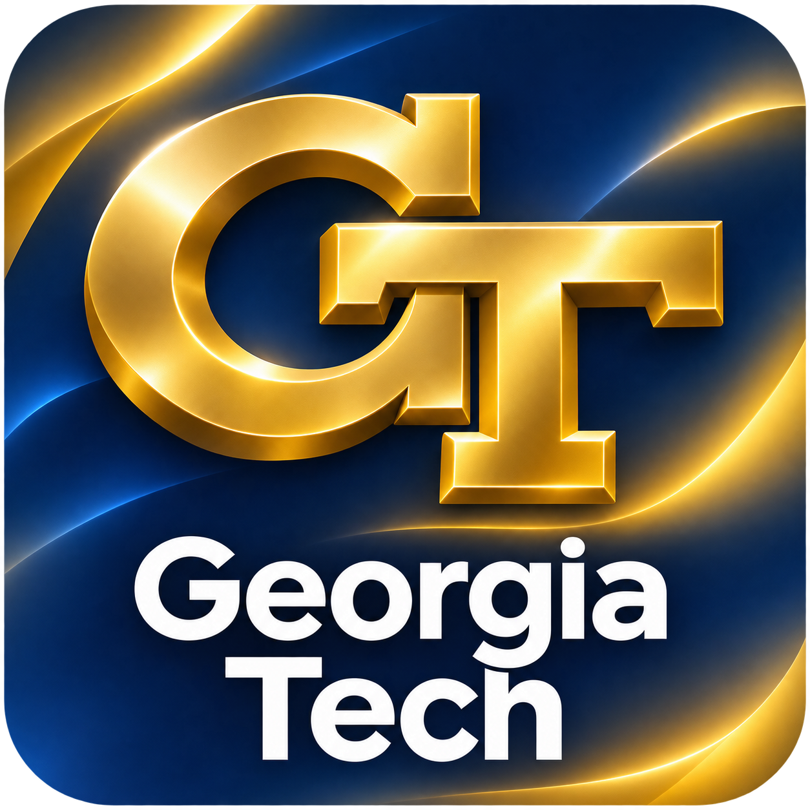
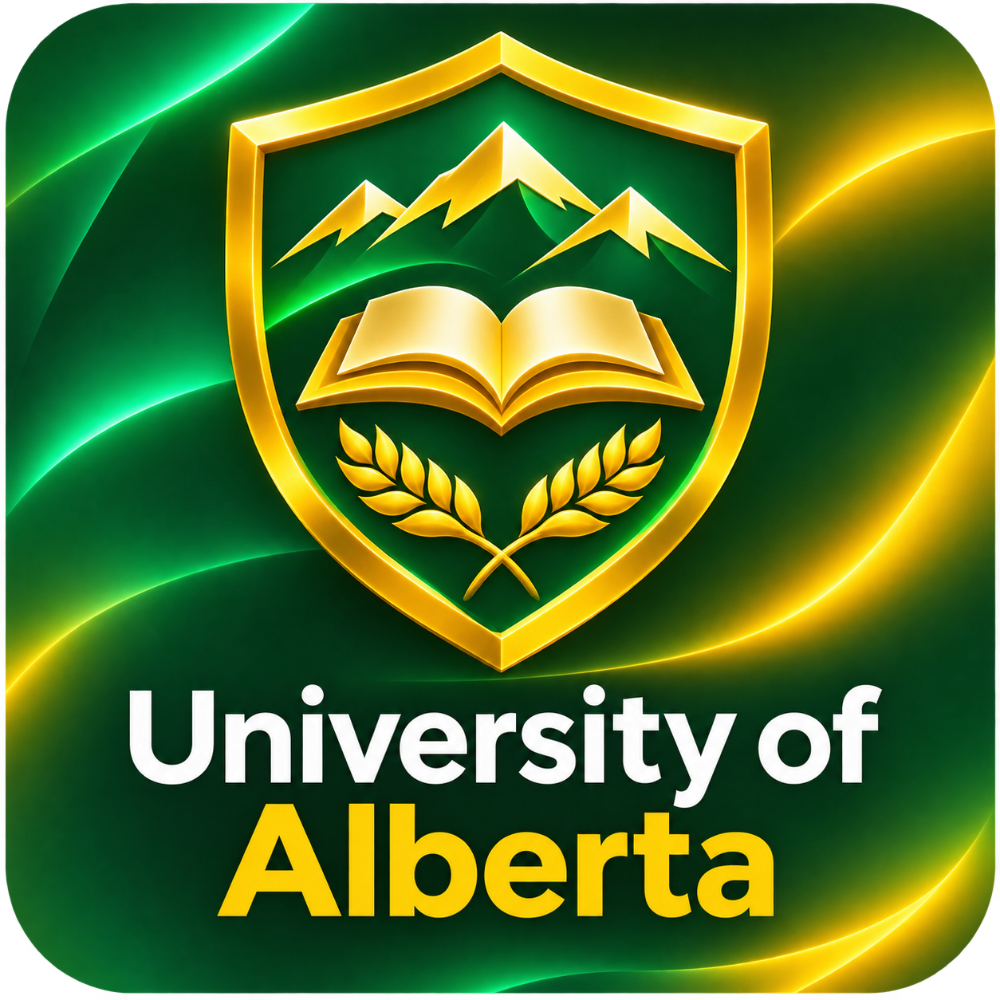
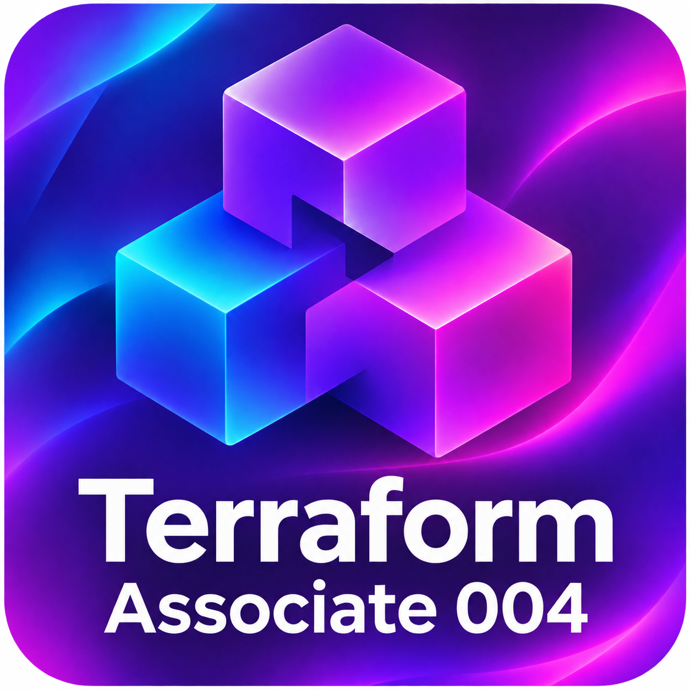
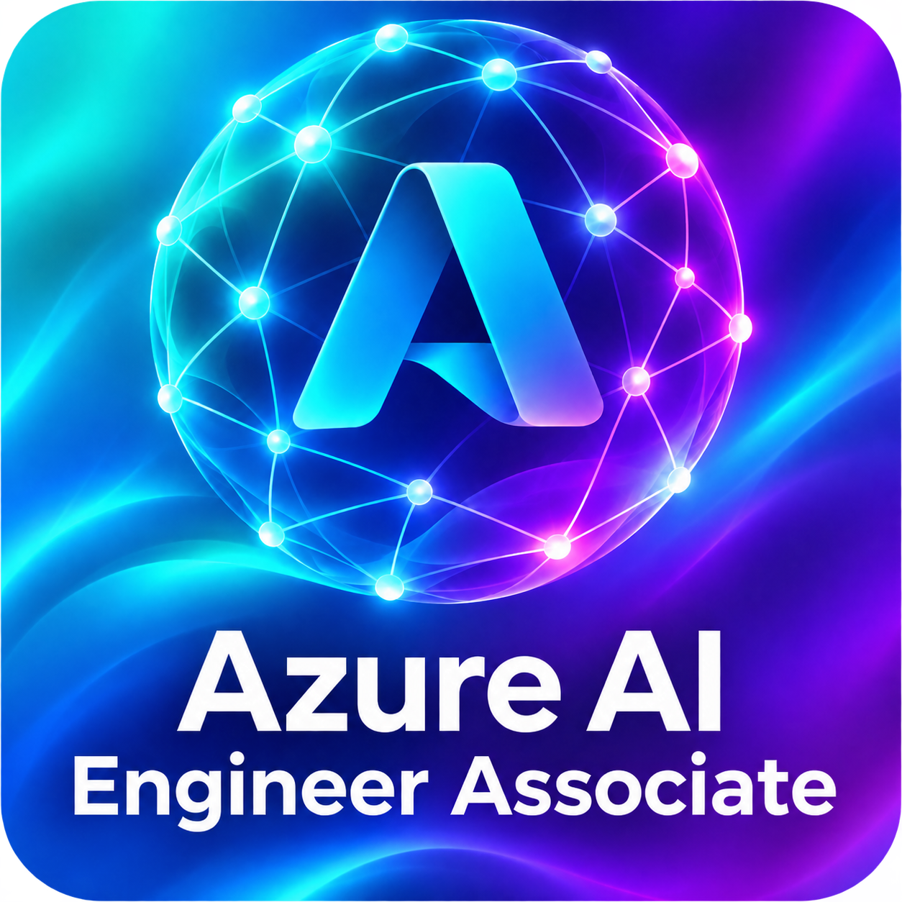
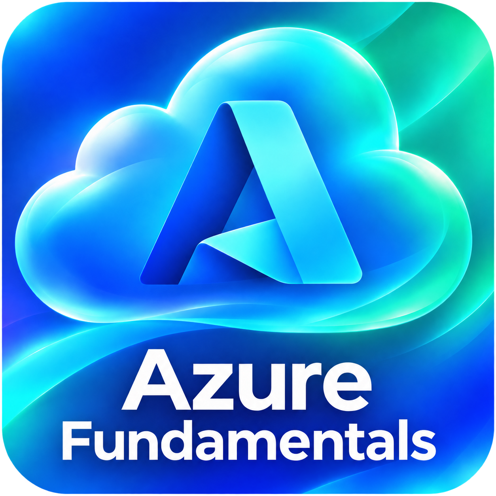

# Richard Omorotionmwan

Platform and infrastructure engineer working across cloud infrastructure and applied AI. I build reliable production systems, automate cloud provisioning and deployments, and develop AI agent workflows and evaluation tools.

## Experience

- **Credian | Founding Engineer:** Provisioning cloud infrastructure with Terraform for a fintech product that provides authorization and policy controls for AI-agent purchases. Building CI/CD workflows to automate code promotion across environments.
- **Meta | Infrastructure Support Engineer, via Crystal Equation:** Supporting production data infrastructure, handling on-call incident triage, and building internal diagnostic and support tools.
- **AIMCo | Data & AI Platform Engineer Intern:** Automated Databricks Unity Catalog infrastructure with Terraform and built Azure DevOps CI/CD pipelines for dbt.
- **Suncor | Data Analyst Co-op:** Built Python, SQL, and PySpark pipelines to automate reporting and data workflows.

## Education

<table>
  <tr>
    <td align="center" valign="top" width="375">
        
      <strong>M.S. in Computer Science</strong> 
      Georgia Institute of Technology 
      Computing Systems specialization  
      <strong>In progress</strong>
    </td>
    <td align="center" valign="top" width="375">
        
      <strong>B.Sc. in Computing Science</strong> 
      University of Alberta 
      Software Practice specialization  
      <strong>Completed</strong>
    </td>
  </tr>
</table>

## Certifications

<table>
  <tr>
    <td align="center" width="250">
       
      HashiCorp  
      <strong>Active</strong> 
      Earned Nov 1, 2026  
      <a href="https://www.credly.com/badges/5090885b-6254-4e2a-9113-6cfe62c7b958">View credential ↗</a>
    </td>
    <td align="center" width="250">
       
      Microsoft  
      <strong>Previously earned</strong> 
      Earned Jun 22, 2024  
      <a href="https://learn.microsoft.com/api/credentials/share/en-us/IHEOMAOMOROTIONMWAN-3538/9079F79037757F38?sharingId=D39D5E5F18B44300">View credential ↗</a>
    </td>
    <td align="center" width="250">
       
      Microsoft  
      <strong>Active</strong> 
      Earned Nov 18, 2023  
      <a href="https://learn.microsoft.com/api/credentials/share/en-us/IHEOMAOMOROTIONMWAN-3538/1ADE50D4ECECD9D8?sharingId=D39D5E5F18B44300">View credential ↗</a>
    </td>
  </tr>
</table>

## Certifications in progress

- Databricks Data Engineer certification
- Certified Kubernetes Administrator (CKA)

## Core tools

Terraform · AWS · Azure · Databricks · Docker · Azure DevOps · Python · SQL · TypeScript

[Email](mailto:iheoma.richard@gmail.com)
