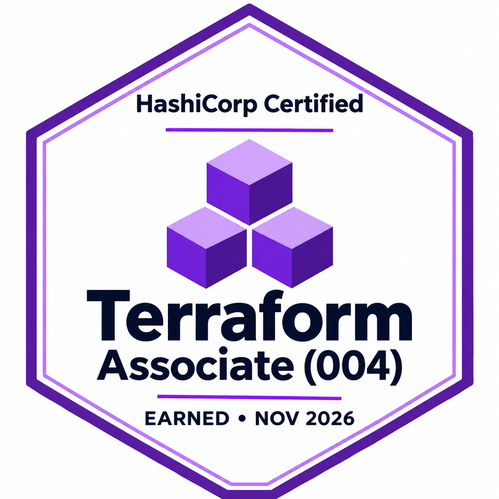
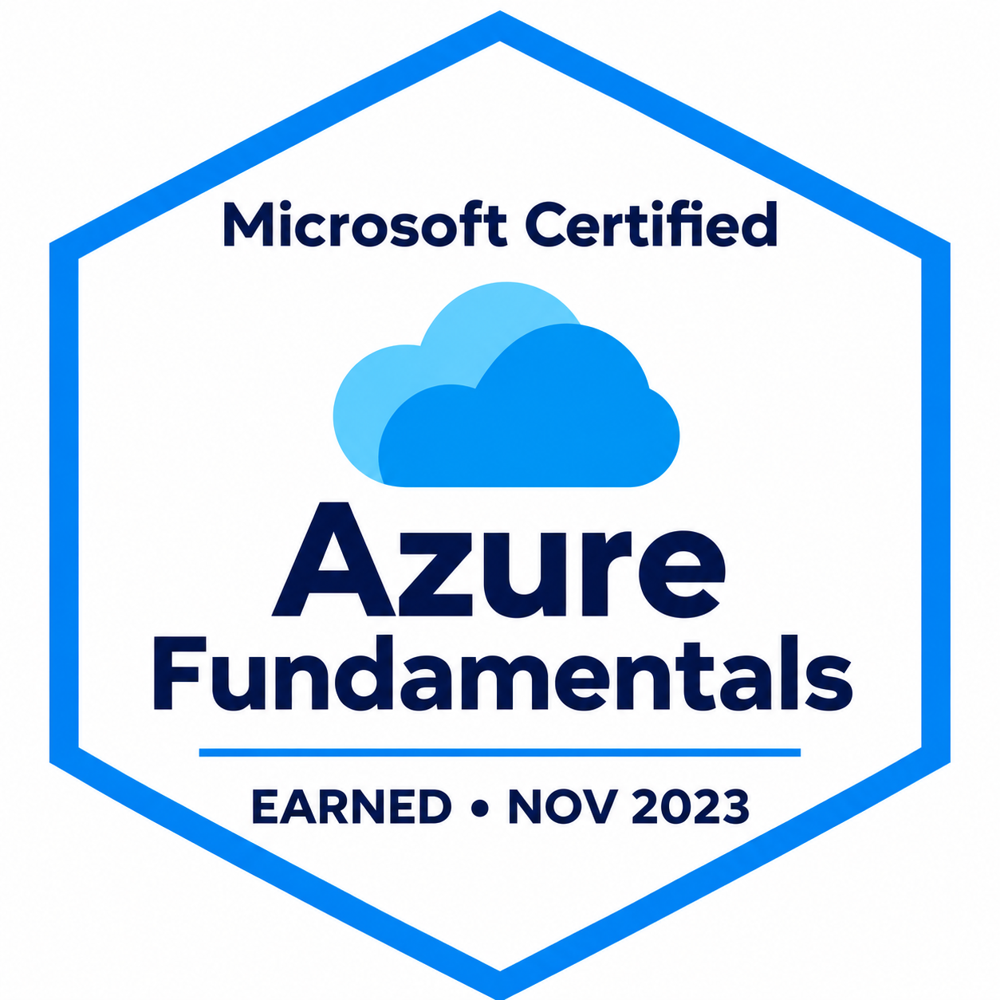
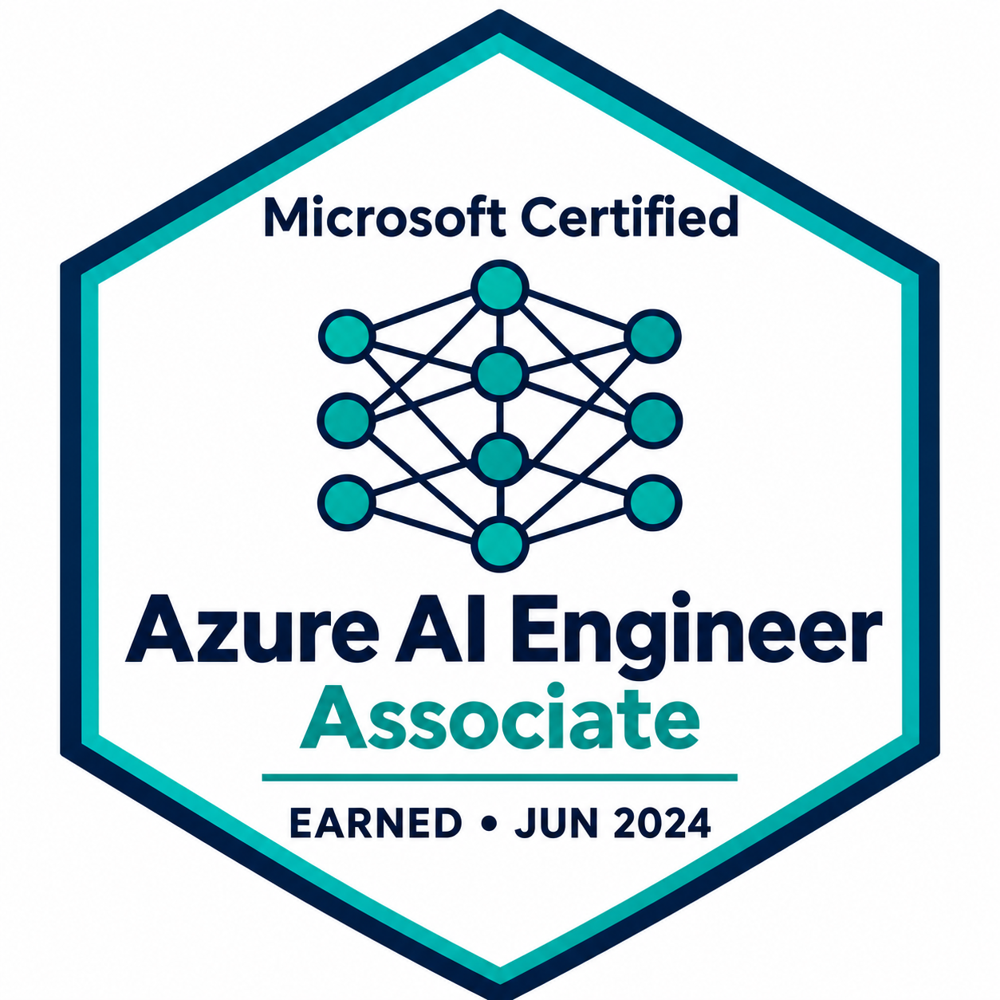

# Richard Omorotionmwan

Platform and infrastructure engineer focused on cloud provisioning, deployment automation, and reliable production systems. B.Sc. in Computer Science from the University of Alberta, with a Software Practice specialization. Currently pursuing an M.S. in Computer Science at Georgia Tech.

## Experience

- **Credian | Founding Engineer:** Provisioning cloud infrastructure with Terraform for a fintech product that provides authorization and policy controls for AI-agent purchases. Building CI/CD workflows to automate code promotion across environments.
- **Meta | Infrastructure Support Engineer, via Crystal Equation:** Supporting production data infrastructure, handling on-call incident triage, and building internal diagnostic and support tools.
- **AIMCo | Data & AI Platform Engineer Intern:** Automated Databricks Unity Catalog infrastructure with Terraform and built Azure DevOps CI/CD pipelines for dbt.
- **Suncor | Data Analyst Co-op:** Built Python, SQL, and PySpark pipelines to automate reporting and data workflows.

## Core tools

Terraform · AWS · Azure · Databricks · Docker · Azure DevOps · Python · SQL · TypeScript

## Certifications

Click a badge to view the official credential and verification details.

  
  
  

- **[HashiCorp Certified: Terraform Associate (004)](https://www.credly.com/badges/5090885b-6254-4e2a-9113-6cfe62c7b958)**: Earned November 1, 2026 · Active through November 1, 2028.
- **[Microsoft Certified: Azure Fundamentals](https://learn.microsoft.com/api/credentials/share/en-us/IHEOMAOMOROTIONMWAN-3538/1ADE50D4ECECD9D8?sharingId=D39D5E5F18B44300)**: Earned November 18, 2023 · Active.
- **[Microsoft Certified: Azure AI Engineer Associate](https://learn.microsoft.com/api/credentials/share/en-us/IHEOMAOMOROTIONMWAN-3538/9079F79037757F38?sharingId=D39D5E5F18B44300)**: Earned June 22, 2024 · Expired June 22, 2025.

## Certifications in progress
- Databricks Data Engineer certification
- Certified Kubernetes Administrator (CKA)

[Email](mailto:iheoma.richard@gmail.com)
